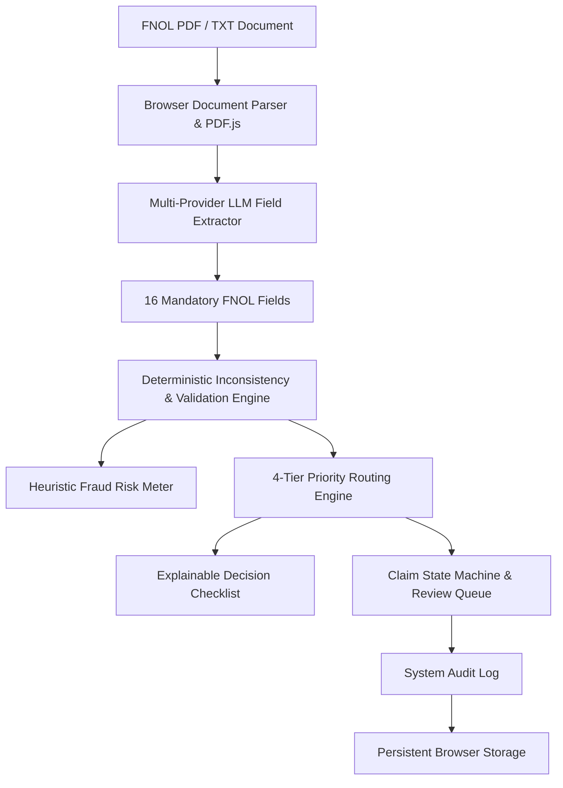

# Synapx- Insurance Intelligence & Claims Operations Console

**Synapx** is a lightweight, zero-install, browser-native engineered for high-throughput First Notice of Loss (FNOL) processing with deterministic validation, explainable AI routing, real-time risk scoring, and enterprise auditability.

---

---

## ⚡ Core Features

| Feature                                        | Description                                                                                                                                                                     |
| ---------------------------------------------- | ------------------------------------------------------------------------------------------------------------------------------------------------------------------------------- |
| 📋 **System Audit Trail**                      | Immutable timestamped audit log of all system decisions, AI calls, validations, human field edits, and state transitions saved to persistent browser storage.                   |
| ⚡ **Deterministic Inconsistency Engine**      | Pure JavaScript validation engine checking policy coverage periods, financial discrepancies, invalid damage values, claim type vs description mismatches, and date logic.       |
| 📊 **AI Evaluation Suite & Confusion Matrix**  | Benchmark suite running synthetic FNOL ground truth tests to calculate extraction accuracy, required field recall, and a 4x4 Routing Confusion Matrix.                          |
| 🔍 **Explainable Routing ("Why this route?")** | Transparent decision panel rendering Priority Rank (1–4), rule code, evidence payload, and a step-by-step evaluation checklist.                                                 |
| 🔄 **Claim State Machine & Review Desk**       | Enforced claim lifecycle states (`UPLOADED` → `EXTRACTING` → `VALIDATING` → `ROUTED` → `PENDING_REVIEW` → `APPROVED` / `REJECTED` / `ESCALATED`) with an adjuster review queue. |
| 🛠️ **Agent Telemetry & Trace View**            | Visual step-by-step execution pipeline showing real-time execution timing, field counts, and validation status.                                                                 |
| 🎨 **Synapx Console Design**                   | Restrained graphite and charcoal enterprise palette, high-density operations panels, strict typography, compact status indicators, and deliberate semantic color accents.       |

---

## 🚀 Architectural Guarantee

> **Note on Zero-Install Architecture:**
> **Synapx** intentionally utilizes a **browser-native HTML/CSS/JavaScript architecture**. There are no backend server requirements (no Python, FastAPI, Express, Node.js, Docker, or external databases). It runs immediately by opening html file in any modern web browser while delivering enterprise-grade autonomous claims operations.

---

## 📋 The 16 Mandatory FNOL Fields

| Category               | Mandatory Schema Fields                                                                  |
| ---------------------- | ---------------------------------------------------------------------------------------- |
| **Policy Details**     | `policyNumber`, `policyholderName`, `effectiveDates`                                     |
| **Incident Details**   | `incidentDate`, `incidentTime`, `incidentLocation`, `incidentDescription`                |
| **Parties Involved**   | `claimantName`, `thirdParties`, `contactDetails`                                         |
| **Asset & Financials** | `assetType`, `assetId`, `estimatedDamage`, `claimType`, `attachments`, `initialEstimate` |

---

## 🎯 Deterministic Routing Priority Rules

Routing decisions are strictly evaluated in priority order by the deterministic engine rather than relying on unconstrained LLM outputs:

1. 🔴 **Priority 1: Investigation Flag** — Triggered if `incidentDescription` contains fraud indicators (`fraud`, `staged`, `inconsistent`, `fabricated`, `suspicious`, `duplicate`, `exaggerated`, `collusion`).
2. 🔵 **Priority 2: Specialist Queue** — Triggered if `claimType === "Injury"` or if medical/injury keywords are present.
3. 🟡 **Priority 3: Manual Review** — Triggered if any of the 16 mandatory fields are missing or if a `CRITICAL` policy inconsistency occurs (e.g. incident date outside policy coverage).
4. 🟢 **Priority 4: Fast-track Settlement** — Triggered if `estimatedDamage < ₹25,000`, all 16 fields are present, and zero validation errors exist.
5. 🟡 **Priority 5: Fallback Manual Review** — Applies to all high-value or complex claims exceeding fast-track thresholds.

---

## 🤖 Supported Multi-Provider AI Infrastructure

Configure your preferred AI provider in the **AI Providers Console** (`sessionStorage` persistence):

| Provider          | Default Model              | API Key Format | Provider Portal                                        |
| ----------------- | -------------------------- | -------------- | ------------------------------------------------------ |
| **Anthropic**     | `claude-sonnet-4-20250514` | `sk-ant-…`     | [console.anthropic.com](https://console.anthropic.com) |
| **OpenAI**        | `gpt-4o`                   | `sk-…`         | [platform.openai.com](https://platform.openai.com)     |
| **Groq**          | `llama-3.3-70b-versatile`  | `gsk_…`        | [console.groq.com](https://console.groq.com)           |
| **Google Gemini** | `gemini-1.5-flash`         | `AIza…`        | [aistudio.google.com](https://aistudio.google.com)     |

---

## ⌨️ Keyboard Shortcuts

| Shortcut       | Function                              |
| -------------- | ------------------------------------- |
| `Ctrl + Enter` | Run Autonomous Agent on current input |
| `Ctrl + L`     | Load quick sample claim               |
| `Ctrl + K`     | Clear processing input textarea       |
| `Ctrl + P`     | Print formatted claim report          |

---

## 👤 Author & License

- **Author:** Thanusha M Hosgoudar
- **GitHub:** https://github.com/ThanushaMH/Insurance_Claims_Processing_Agent
